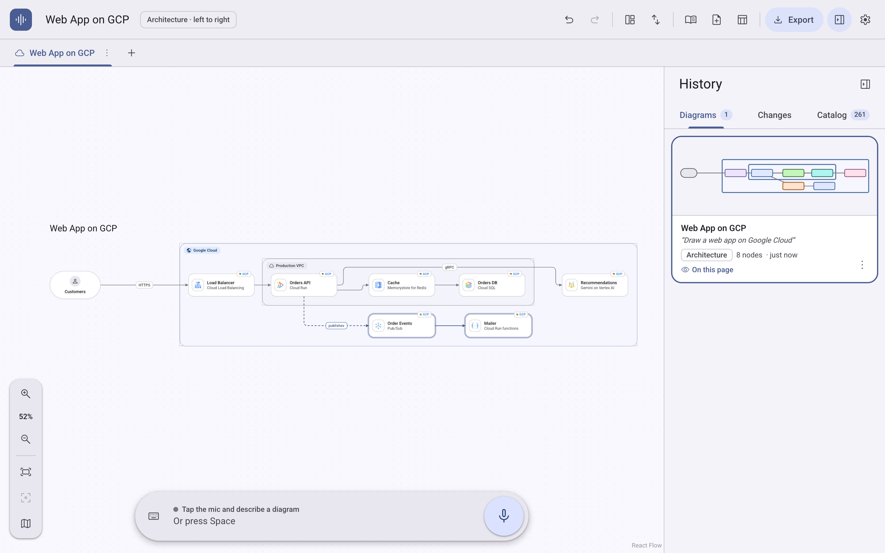
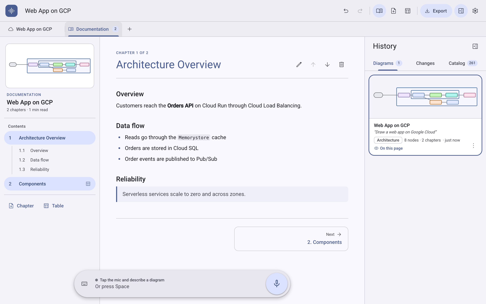
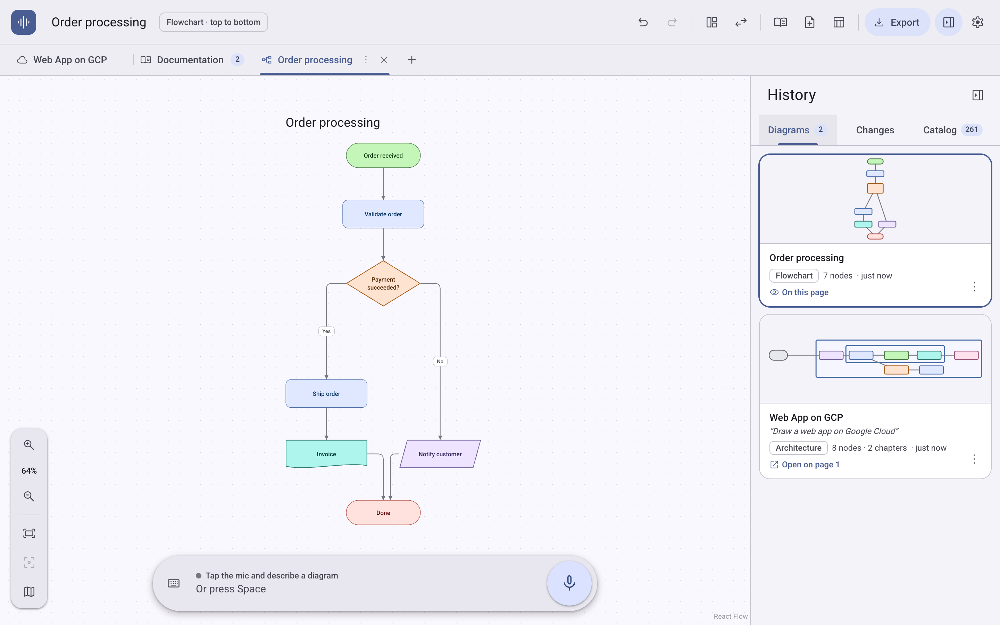

# Voice Diagram Studio

[](LICENSE)

A **voice-first diagram editor** powered by the **Gemini Live API**: speak a diagram into existence, then keep talking to refine it.

Every voice or text request is a **precise incremental edit** of what is on the canvas—never a full redraw that scrambles your layout. Each diagram has its own **Book Documentation** tab (chapters, sections, tables, and live Table of Contents), diagrams live across multiple page tabs, and every generated diagram stays in the history panel. Everything exports to **draw.io (`.drawio`)** and **Markdown (`.md`)**.

<p align="center">
  <picture>
    <source media="(prefers-color-scheme: dark)" srcset="docs/screenshots/diagram-dark.png">
    
  </picture>
</p>

<details>
<summary><strong>More screenshots (Book Documentation view & Flowcharts)</strong></summary>
<br>

**Book-style Documentation tab** (chapters, table of contents, and structured component tables):

<p align="center">
  <picture>
    <source media="(prefers-color-scheme: dark)" srcset="docs/screenshots/docs-dark.png">
    
  </picture>
</p>

**Multi-page tabs & Diagram History** (flowcharts, architecture diagrams, and instant history restore):

<p align="center">
  <picture>
    <source media="(prefers-color-scheme: dark)" srcset="docs/screenshots/flowchart-dark.png">
    
  </picture>
</p>

</details>

---

## Quick Start

Requires **Node.js 20.19+** and a [Gemini API key](https://aistudio.google.com/apikey).

```bash
./studio.sh          # installs dependencies, prompts for your Gemini API key once, opens http://127.0.0.1:5173
./studio.sh key      # saves or replaces your key (macOS Keychain or mode-600 .env.local); forget-key deletes it
./studio.sh check    # verifies key → ephemeral token → Live session against the real Gemini API
./studio.sh test     # runs unit + security tests
./studio.sh e2e      # runs headless Chrome E2E tests (UI smoke + mock Live voice pipeline)
./studio.sh eval     # runs multi-turn stability & accuracy evals against the real Gemini Live model
```

> **Security by design:** Your Gemini API key stays on the local server and **never reaches the browser**. The browser connects to Gemini Live using single-use, setup-locked [ephemeral tokens](https://ai.google.dev/gemini-api/docs/ephemeral-tokens) minted by [`studio/server/liveToken.ts`](studio/server/liveToken.ts).

---

## What You Can Ask For

Press **Space** (or click the mic) to talk, or press **`/`** to type a request:

| Say | Gemini Live tool call |
| --- | --- |
| *"Draw a web app on Google Cloud with Cloud Run, Cloud SQL, and Vertex AI"* | `create_diagram` (creates the diagram with a title and initial ELK layout) |
| *"Add a Redis cache between the API and the database"* | `edit_diagram` (places the new node between neighbors without reshuffling unrelated nodes) |
| *"Document this architecture"* (or **Document this diagram** in an empty Documentation tab) | `write_text` + `write_table`: an [arc42-style book](studio/README.md#how-gemini-writes-architecture-documentation) — goals, context, building blocks, runtime view, deployment, cross-cutting concepts, ADRs, risks |
| *"Add an ADR for the cache"*, *"Write a runbook for a database outage"* | `write_text` (one chapter, or one more decision record appended to `decisions`) |
| *"Add a table of components, ports, and responsibilities"* | `write_table` (adds a structured table chapter to the Documentation tab) |
| *"Update the documentation"* (after the diagram changed) | `write_text` / `write_table` on the stale chapters only, by their stable ids |
| *"Open the documentation"*, *"Go back to the diagram"* | `switch_page` with `view: "documentation"` / `"diagram"` |
| *"Now draw the checkout flow in a new tab"* | `create_diagram` with `new_page: true` (preserves the current diagram on its tab) |
| *"Go to the first tab"*, *"Rename this tab"*, *"Close the security tab"* | `switch_page`, `rename_page`, `delete_page` |
| *"Zoom in"*, *"Show everything"*, *"Zoom on the database"* | `change_view` |

### Keyboard Shortcuts

| Action | Shortcut |
| --- | --- |
| Talk (push-to-toggle mic) | **Space** |
| Type a request | **`/`** |
| Undo / Redo | **⌘Z** / **⇧⌘Z** |
| Rename selected node or edit chapter | **Enter** |
| Zoom in / out | **⌘+** / **⌘−** (or ⌘ + scroll / pinch) |
| Zoom to 100% / Fit all / Fit selection | **⌘0** (or **⇧0**) / **⇧1** / **⇧2** |
| Toggle Minimap | **M** |

---

## How Edits Stay Consistent

| Common flaw in LLM diagram tools | How Voice Diagram Studio solves it |
| --- | --- |
| Every change redraws the entire diagram from scratch | Gemini edits via `edit_diagram`: typed operations on stable IDs (`add`/`update`/`remove` nodes, edges, groups) applied atomically as a single undo step ([`ops.ts`](studio/src/engine/ops.ts)). |
| The model cannot see manual canvas changes | Every tool response returns a compact, exact summary of the current canvas state ([`summary.ts`](studio/src/engine/summary.ts)), including manual user edits and the current selection. |
| Node positions reshuffle on every prompt | New nodes are placed relative to their neighbors ([`placement.ts`](studio/src/engine/placement.ts)). Existing nodes stay where they are (only downstream nodes shift when inserting between two connected nodes). Full ELK layout runs only on initial creation or *"tidy up"*. |
| Hallucinated calls can wipe out a diagram | Edit batches are validated before application and rejected with actionable error messages; removing >1/3 of a diagram requires `confirm_large_removal`; calling `create_diagram` on a non-empty page requires `new_page: true` or explicit `replace: true`. |
| Long text blocks clutter the diagram canvas | Documentation lives in a dedicated **Documentation** tab per diagram ([`book.ts`](studio/src/engine/book.ts), [`DocView.tsx`](studio/src/ui/DocView.tsx)), formatted like a book with numbered chapters and a table of contents. |
| Spoken names don't match internal node IDs | Spoken phrases like *"the database"* or *"payment service"* automatically resolve to node IDs by label, technology, or kind ([`resolve.ts`](studio/src/engine/resolve.ts)). |

---

## Ephemeral Token Security

The browser never receives `GEMINI_API_KEY`:

```text
Browser ── POST /api/live/token ──▶ Studio server (holds API key) ── x-goog-api-key ──▶ Google auth_tokens
Browser ◀────── single-use token ──────┘
Browser ── wss://…BidiGenerateContentConstrained?access_token=… ──▶ Gemini Live API
```

- **Key storage:** `./studio.sh key` stores the key in the **macOS Keychain** via `stdin` (so it never appears in process lists), or in git-ignored `studio/.env.local` (`chmod 600`) on Linux/CI. `GEMINI_API_KEY` in the environment takes precedence.
- **Single-use, locked tokens:** Each token starts at most 1 session within 60 seconds, expires after 30 minutes, and is locked via `fieldMask` to the allowed model, voice, system instruction, and tool declarations ([`studio/server/liveToken.ts`](studio/server/liveToken.ts)).
- **Local endpoint hardening:** Bound to `127.0.0.1` by default, enforces same-origin and host allow-listing (preventing cross-site calls and DNS rebinding), caps JSON payloads at 2 KB, and rate-limits token minting per client.

---

## Repository Structure

```text
studio/
  src/engine/   Pure TypeScript scene model, edit operations, neighbor placement, ELK layout,
                edge routing, undo history, book documentation, workspace & 260+ cloud catalog items
  src/agent/    Gemini Live tool declarations, system prompt, tool dispatcher, voice session controller
  src/voice/    Live API WebSocket client & setup, ephemeral token fetcher, Web Audio mic/playback
  src/ui/       React 19 + React Flow canvas, book documentation view, Material 3 dynamic theming
  server/       Ephemeral token middleware (the only code that reads GEMINI_API_KEY), Vite plugin, API check
  test/         Vitest unit tests for the diagram engine, workspace, and token server security
  e2e/          Playwright browser tests (UI smoke test + mock Gemini Live WebSocket server)
  eval/         Multi-turn conversation benchmark scored against the real Gemini Live model
```

See [`studio/README.md`](studio/README.md) for detailed configuration, deployment notes, and evaluation options.

---

## License & Trademarks

- **Source code:** Licensed under the [MIT License](LICENSE).
- **Icons & Trademarks:** Google Cloud product and category icons in [`studio/public/gcp-icons/`](studio/public/gcp-icons) are property and trademarks of Google LLC and are included solely for architecture diagramming representation. This project is an independent open-source tool and is not officially affiliated with or endorsed by Google.
